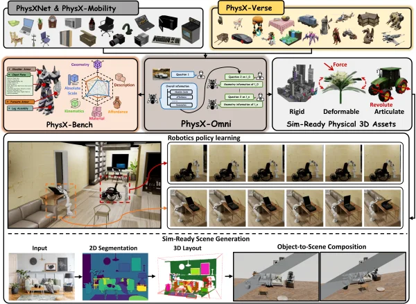

## About Me

I am Haitian Li, a Master's student in Artificial Intelligence (MSAI) at Nanyang Technological University (NTU), at MMLab@NTU, under the supervision of Research Fellow <a href="https://www.infinitescript.com/about/">Haozhe Xie</a> and Prof. <a href="https://liuziwei7.github.io/">Ziwei Liu</a>. Previously, I obtained my Bachelor's degree from Wuhan University.

My research focuses on computer vision, particularly 3D vision. I am motivated by the potential of AI to enhance productivity and make a positive impact on the world.

---

## Publications <a href="https://scholar.google.com/citations?user=oRN_HLQAAAAJ&hl=en" style="font-size: 0.7em; margin-left: 8px;">[Google Scholar]</a>

  

    
  

  

    <strong style="font-size: 1.05em;">PhysX-Omni: Unified Simulation-Ready Physical 3D Generation for Rigid, Deformable, and Articulated Objects</strong> 
    <em>arXiv, 2026</em> 
    Ziang Cao, Yinghao Liu, <strong>Haitian Li</strong>, Runmao Yao, Fangzhou Hong, Zhaoxi Chen, Liang Pan, and Ziwei Liu 
    

      <a href="https://physx-omni.github.io/">[Project]</a>
    

  

  

    <video src="/images/paper/Monoart.mp4" autoplay loop muted playsinline preload="none" poster="/images/paper/monoart-teaser.jpg" style="width: 100%; border-radius: 4px; object-fit: cover; aspect-ratio: 4/3; background: #f5f5f5;"></video>
  

  

    <strong style="font-size: 1.05em;">MonoArt: Progressive Structural Reasoning for Monocular Articulated 3D Reconstruction</strong> 
    <em>European Conference on Computer Vision (ECCV), 2026</em> 
    <strong>Haitian Li</strong>*, Haozhe Xie*, Junxiang Xu, Beichen Wen, Fangzhou Hong, and Ziwei Liu 
    

      <a href="/MonoArt/" style="margin-right: 10px;">[Project]</a>
      <a href="https://arxiv.org/abs/2603.19231" style="margin-right: 10px;">[Paper]</a>
      <a href="https://github.com/Quest4Science/MonoArt">[Code]</a>
    

  

  

    <video src="/images/paper/trans-adapter.mp4" autoplay loop muted playsinline preload="none" style="width: 100%; border-radius: 4px; object-fit: cover; aspect-ratio: 4/3;"></video>
  

  

    <strong style="font-size: 1.05em;">Trans-Adapter: A Plug-and-Play Framework for Transparent Image Inpainting</strong> 
    <em>International Conference on Computer Vision (ICCV), 2025</em> 
    Yuekun Dai, <strong>Haitian Li</strong>, Shangchen Zhou, and Chen Change Loy 
    

      <a href="https://ykdai.github.io/projects/trans-adapter" style="margin-right: 10px;">[Project]</a>
      <a href="https://arxiv.org/abs/2508.01098" style="margin-right: 10px;">[Paper]</a>
      <a href="https://github.com/ykdai/trans-adapter">[Code]</a>
    

  

